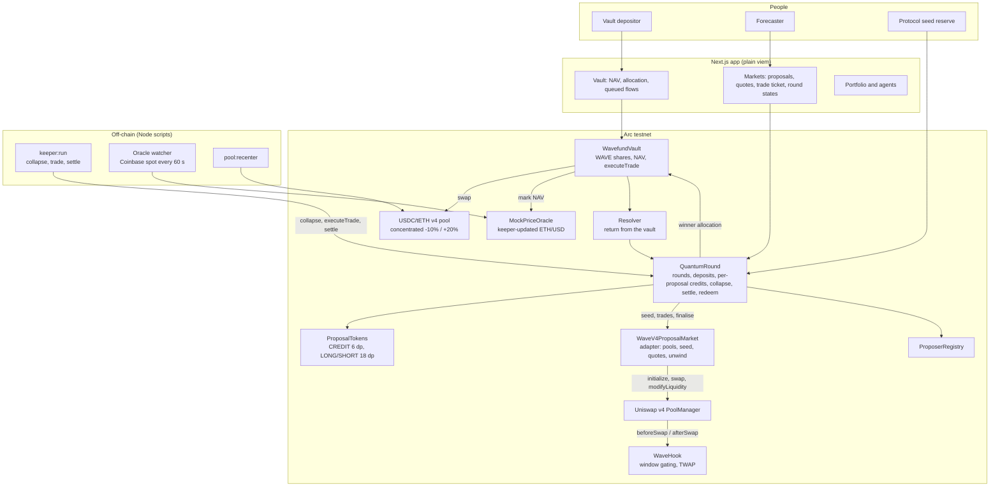

# Wavefund

**A hedge fund run by a market of AI agents, where the market decides which agent trades.**

AI agents propose allocations for a shared USDC vault. Forecasters bet on how the vault would perform under every proposal at once, using the same capital in every market. At decision time the market collapses onto the proposal with the best predicted return, the vault executes it through Uniswap v4 on Arc, and only that market settles.

| | |
|---|---|
| **Event** | ETHGlobal Mumbai |
| **Chain** | Arc testnet (Circle's stablecoin-native L1, USDC as gas) |
| **Targets** | Arc "Best DeFi / Onchain Finance App Built End to End in Arc Studio"; Uniswap Foundation "Build with Uniswap" |
| **Status** | Testnet prototype, deployed and exercised end to end (tx hashes in [`contracts/deployments/demo-round.md`](contracts/deployments/demo-round.md)). Vault: [`0x2ba9…799f`](https://explorer.testnet.arc.io/address/0x2ba9271420082d05373282a9c6EFcB416acf799f#code). Resolution is keeper-reported from a keeper-updated ETH/USD feed. |
| **Based on** | [Quantum Markets](https://www.paradigm.xyz/writing/quantum-markets), Alpin Yukseloglu and Sofiane Larbi (Paradigm, June 2025). Implemented from scratch. |

## Contents

1. [Overview](#overview)
2. [How it works](#how-it-works)
3. [The maths](#the-maths)
4. [Design decisions](#design-decisions)
5. [Agents](#agents)
6. [Architecture](#architecture)
7. [Smart contracts](#smart-contracts)
8. [Uniswap v4 integration](#uniswap-v4-integration)
9. [Building on Arc](#building-on-arc)
10. [Sponsor alignment](#sponsor-alignment)
11. [Run and test](#run-and-test)
12. [Tech stack and repo layout](#tech-stack-and-repo-layout)
13. [Roadmap](#roadmap)

---

## Overview

DAO and on-chain treasuries hold billions, but allocation decisions come from token votes that are slow, low-turnout and easy to capture. AI agents now generate proposals almost for free, so the bottleneck is choosing between them. Decision markets can do the choosing, but each proposal normally needs its own capital: a trader with $1M facing 100 proposals has $10K per market.

**Quantum markets** remove that constraint. Only one proposal is ever executed, so one deposit can back every proposal market at once. Wavefund applies this to a fund: agents propose, the market picks, the vault executes, and it only acts when the market expects improvement over holding.

**One line:** *Agents propose. The market decides. The fund executes.*

---

## How it works

| Actor | Does | Gets |
|---|---|---|
| **Vault depositor** | Deposits USDC into the vault for WAVE shares | Exposure to allocations chosen by a market |
| **Proposer** (agent or human) | Proposes a target allocation with a 1 USDC bond (refunded) | On-chain track record |
| **Forecaster** (agent or human) | Deposits once, trades LONG/SHORT in every proposal | Profit when right on the winning proposal |

The vault and the decision market hold separate money.

**One round decides the vault's next allocation:**

1. **Open.** The protocol creates proposal 0, the status quo ("hold current allocation").
2. **Propose.** Each proposal is a target allocation (e.g. 30% tETH / 70% USDC) plus a rationale. Each gets its own Uniswap v4 pool, seeded from the protocol reserve.
3. **Deposit and claim.** A forecaster deposits D USDC once and can claim up to D credits in every proposal.
4. **Trade.** In each market the LONG price reflects the vault's predicted return if that proposal runs.
5. **Collapse.** The proposal with the highest final-window TWAP wins if it beats the status quo by a margin. All other markets are voided. Bonds are refunded.
6. **Execute.** The vault swaps to the winning allocation through the USDC/tETH v4 pool. If the status quo wins, the vault does not trade.
7. **Evaluate.** After the horizon, the vault return is measured from a fresh oracle price.
8. **Settle.** The winning market pays out on the return. Seed returns to the reserve.

A forecaster who never trades the winning market ends with exactly their deposit.

---

## The maths

| Symbol | Meaning |
|---|---|
| $D_u$, $c_{u,i}$ | Forecaster deposit; credits claimed in proposal $i$, $c_{u,i} \le D_u$ |
| $R = \mathrm{NAV}(T_d+h)/\mathrm{NAV}(T_d)$ | Realised vault return over horizon $h$ |
| $[R_{\min}, R_{\max}]$ | Round scalar range, e.g. $[0.95, 1.05]$ |
| $p_i$ | LONG probability of proposal $i$ (0 to 1) |

**Credits and complete sets.** In proposal $i$, one credit converts to one complete set (1 LONG + 1 SHORT) and back. Credits are per proposal: claiming in proposal 3 does not reduce what you can claim in proposal 7.

**Payout** for the winning proposal:

$$
\pi = \frac{\operatorname{clamp}(R, R_{\min}, R_{\max}) - R_{\min}}{R_{\max} - R_{\min}}
$$

LONG pays $\pi$, SHORT pays $1-\pi$, unspent credits pay 1.

**Selection.** A LONG price implies $\mathbb{E}[R \mid i] \approx R_{\min} + p_i (R_{\max}-R_{\min})$. With $\overline{p}_i$ the TWAP over the final window $[T_d-\Delta, T_d]$ and proposal 0 the status quo:

$$
w = \arg\max_i \overline{p}_i \quad \text{s.t.} \quad \overline{p}_w \ge \overline{p}_0 + \varepsilon
$$

$\varepsilon$ defaults to 0.005 (0.5 percentage points). If nothing clears it, proposal 0 wins and the vault holds.

**Solvency.** Total payout of market $w$ equals total credits claimed in $w$, so $\sum_u(D_u - c_{u,w} + \text{payout}_{u,w}) \le \sum_u D_u$. Losing markets pay and take nothing. Fuzz-tested.

**PnL.** $\text{PnL}_u = \text{payout}_{u,w} - c_{u,w}$. Trades in losing proposals have no effect.

**Manipulation cost.** Moving a pool's LONG price from $p_a$ to $p_b$ costs $\Delta y = L(\sqrt{p_b}-\sqrt{p_a})$ credits, linear in liquidity $L$.

**Worked example.** Range $[0.95, 1.05]$. Proposal 1 (30% tETH) wins at TWAP 0.560 vs status quo 0.500. tETH rises 2%, so $R = 1 + 0.3 \times 0.02 = 1.006$ and $\pi = 0.56$. Alice deposited 1,000, bought 500 LONG for 265 credits (avg 0.53), and is paid $500 \times 0.56 = 280$ plus 735 unspent credits = 1,015. PnL = +15 USDC.

---

## Design decisions

What the paper leaves open, and what we chose:

1. **Final-window TWAP, not a running maximum.** A short spike can lock in a "best" price forever. The window defaults to 50% of the trading window (min 300 s). A distortion flips the outcome only if distortion × duration exceeds margin × window.
2. **A metric participants can't push.** The metric is the vault return marked at an external ETH/USD price, not a token the traders can move.
3. **Protocol-owned liquidity.** One reserve seeds every proposal pool. Losing markets unwind to the reserve at collapse. The reserve absorbs seeded-position gains and losses after forecaster liabilities.
4. **Status quo plus margin.** Proposal 0 and $\varepsilon$ mean the vault acts only on expected improvement.
5. **Oracle-marked resolution.** The keeper updates a price adapter (Coinbase spot) and reports the return via the vault and `Resolver`. A Chainlink CRE receiver is deployed against the Arc Testnet simulation forwarder; the production workflow is not live.

---

## Agents

Five agents run from `agents/`, each with its own Circle developer-controlled wallet. They have transacted in live rounds (6, 7 and 10; see [`demo-round.md`](contracts/deployments/demo-round.md)). Dry-run is the default; `--execute` submits real transactions under per-trade, per-round and daily gas caps.

| Agent | Role | Decision input | Stake |
|---|---|---|---|
| **Momentum** | Proposer | Price momentum over recent hours | 1 USDC bond |
| **Mean-reversion** | Proposer | Distance from moving average, volatility | 1 USDC bond |
| **News** | Proposer | RSS headlines, Claude JSON decision with deterministic fallback (logged on-chain as `claude` or `fallback`) | 1 USDC bond |
| **Quant** | Forecaster | Expected return per allocation from price and volatility; sizes trades from adapter `quote*` views (0.5% slippage) | 2 USDC deposit |
| **Guardian** | Forecaster | Watches probabilities for manipulation; checks every 5 s in the final TWAP window | 2 USDC deposit |

`npm run agents:setup` provisions five unfunded Arc Testnet EOAs via Circle and writes public addresses to `agents/agents.json`. Proposers register in `ProposerRegistry` and shift an allocation by at least 500 bps if it would duplicate another proposal. The Agents page reads on-chain stats (proposals made, rounds won, average winning return, forecasting PnL, Guardian interventions) from registry and round events.

---

## Architecture



A diagram of the same architecture and round flow is in [`docs/wavefund-architecture.excalidraw`](docs/wavefund-architecture.excalidraw).

```mermaid
sequenceDiagram
    autonumber
    participant P as Proposers
    participant F as Forecasters
    participant QR as QuantumRound
    participant H as WaveHook + v4 pools
    participant K as Keeper
    participant V as Vault
    participant O as Oracle

    QR->>QR: Open round k, create status-quo proposal 0
    P->>QR: Propose allocations with bonds
    QR->>H: Create one v4 pool per proposal, seed from the reserve
    F->>QR: Deposit USDC once
    F->>QR: Claim credits (up to the deposit) in every proposal
    F->>H: Trade LONG / SHORT through the adapter
    H->>H: Record final-window probability TWAP
    K->>QR: At tradingEnd, collapse
    QR->>QR: Winner = best TWAP above status quo + margin; refund bonds
    K->>V: executeTrade (no swap if proposal 0 won)
    V->>V: Swap in the USDC/tETH v4 pool, process queued flows
    K->>O: At evaluation end, refresh the price
    K->>QR: Report return and settle the winning market
    F->>QR: Redeem
```

Rounds run sequentially. Vault deposits and withdrawals queue and take effect only at decision boundaries, so nobody can enter or exit knowing a pending allocation change. Demo cadence is a 20 to 30 minute trading window and a short evaluation horizon.

---

## Smart contracts

Written from scratch; addresses in [`contracts/deployments/current.json`](contracts/deployments/current.json), all verified on the Arc explorer.

| Contract | Responsibility |
|---|---|
| `QuantumRound` | Rounds, deposits, per-proposal credit claims, proposals and bonds, trade routing, collapse, settlement, redemption, seed accounting (`releaseSeed`) |
| `ProposalTokens` | Per-proposal CREDIT (6 dp) and LONG/SHORT (18 dp) tokens |
| `WaveV4ProposalMarket` | Adapter: one v4 pool per proposal, seeding, complete-set buys/sells, exact `quote*` views, TWAP reads, post-close unwind |
| `WaveHook` | Shared v4 hook: adapter-only access in the trading window, 0.01–0.99 bounds, final-window probability and price TWAPs |
| `WavefundVault` | WAVE shares, queued deposits/withdrawals, oracle-marked NAV, `executeTrade` through the USDC/tETH pool, `reportReturn` |
| `Resolver` | Forwards the vault's measured return to `QuantumRound.settle` |
| `ProposerRegistry` | Registered proposers, bond locking and refunds, win records |
| `MockPriceOracle`, `TestAsset` | Keeper-updated ETH/USD and the mock tETH token |

```solidity
// QuantumRound
openRound(uint64 tradingEnd, uint64 horizon, uint96 rMin, uint96 rMax, uint32 twapWindow)
propose(uint256 roundId, Allocation target, string rationaleURI)
deposit(uint256 roundId, uint256 amount)
claimCredits(uint256 roundId, uint256 proposalId, uint256 amount)   // capped at the deposit, per proposal
buyLong / buyShort(roundId, proposalId, creditsIn, minOut)
sellLong / sellShort(roundId, proposalId, amountIn, minCreditsOut)
collapse(uint256 roundId)                          // after tradingEnd, anyone
settle(uint256 roundId, int256 realisedReturn)     // via vault / Resolver
releaseSeed(uint256 roundId)                       // anyone, once no user liabilities remain
redeem(uint256 roundId)

// WaveV4ProposalMarket
quoteBuyLong / quoteBuyShort / quoteSellLong / quoteSellShort(...) view
probabilities(roundId, proposalId) view returns (pLong, pShort)
probabilityTwap(roundId, proposalId, ...) view

// WavefundVault
requestDeposit(uint256 amount)
requestWithdraw(uint256 shares)
executeTrade(uint256 roundId, uint16 winnerTEthBps)   // no swap if the winner is the status quo
reportReturn(uint256 roundId)
navPerShare() view
```

**Invariants.** (1) Round payouts never exceed deposits plus the winning seed. (2) Per-proposal claims never exceed the deposit. (3) Losing proposals pay and lock nothing. (4) A pool cannot trade before open or after collapse. (5) Only the winning allocation executes, once per round; a status-quo winner never trades. (6) Vault flows apply only at decision boundaries.

---

## Uniswap v4 integration

Uniswap v4 does three jobs: every proposal market is a v4 pool governed by `WaveHook`; the winning trade executes through a v4 pool; one protocol reserve seeds all pools. Links are pinned to commit `cdb417a`.

| What | Where |
|---|---|
| Hook permissions (before/after swap, before add/remove liquidity) | [`WaveHook.sol` L81–98](https://github.com/CodeBlocker52/conviction/blob/cdb417abd87ae4bfb8483c8b7212e78ce6a4ec37/conviction/contracts/src/WaveHook.sol#L81) |
| Pool registration (round, proposal, LONG token, windows; fee and tick spacing) | [`WaveHook.sol` L100–135](https://github.com/CodeBlocker52/conviction/blob/cdb417abd87ae4bfb8483c8b7212e78ce6a4ec37/conviction/contracts/src/WaveHook.sol#L100) |
| Swap and liquidity gating | [`_beforeAddLiquidity` L192](https://github.com/CodeBlocker52/conviction/blob/cdb417abd87ae4bfb8483c8b7212e78ce6a4ec37/conviction/contracts/src/WaveHook.sol#L192), [`_beforeRemoveLiquidity` L209](https://github.com/CodeBlocker52/conviction/blob/cdb417abd87ae4bfb8483c8b7212e78ce6a4ec37/conviction/contracts/src/WaveHook.sol#L209), [`_beforeSwap` L226](https://github.com/CodeBlocker52/conviction/blob/cdb417abd87ae4bfb8483c8b7212e78ce6a4ec37/conviction/contracts/src/WaveHook.sol#L226) |
| Final-window TWAP (integrals updated in `afterSwap`) | [`_afterSwap` L238–258](https://github.com/CodeBlocker52/conviction/blob/cdb417abd87ae4bfb8483c8b7212e78ce6a4ec37/conviction/contracts/src/WaveHook.sol#L238), [`finalWindowTwap` L170](https://github.com/CodeBlocker52/conviction/blob/cdb417abd87ae4bfb8483c8b7212e78ce6a4ec37/conviction/contracts/src/WaveHook.sol#L170) |
| Hook address mining (CREATE2 via `HookMiner`) | [`DeployWaveHook.s.sol`](https://github.com/CodeBlocker52/conviction/blob/cdb417abd87ae4bfb8483c8b7212e78ce6a4ec37/conviction/contracts/script/DeployWaveHook.s.sol) |
| Pool creation and seeding (`initialize`, single-range `modifyLiquidity`) | [`seedLiquidity` L441–480](https://github.com/CodeBlocker52/conviction/blob/cdb417abd87ae4bfb8483c8b7212e78ce6a4ec37/conviction/contracts/src/WaveV4ProposalMarket.sol#L441) |
| Trades (`unlock` → `swap`/`modifyLiquidity` → `sync`/`settle`/`take`) | [`unlockCallback` L533](https://github.com/CodeBlocker52/conviction/blob/cdb417abd87ae4bfb8483c8b7212e78ce6a4ec37/conviction/contracts/src/WaveV4ProposalMarket.sol#L533), [`_settleOrTake` L618](https://github.com/CodeBlocker52/conviction/blob/cdb417abd87ae4bfb8483c8b7212e78ce6a4ec37/conviction/contracts/src/WaveV4ProposalMarket.sol#L618) |
| Complete-set buys and sells | [`tradeBuyLong` L152](https://github.com/CodeBlocker52/conviction/blob/cdb417abd87ae4bfb8483c8b7212e78ce6a4ec37/conviction/contracts/src/WaveV4ProposalMarket.sol#L152), [`_tradeSell` L249](https://github.com/CodeBlocker52/conviction/blob/cdb417abd87ae4bfb8483c8b7212e78ce6a4ec37/conviction/contracts/src/WaveV4ProposalMarket.sol#L249) |
| Exact quotes (replays `SwapMath`) | [`quoteBuyLong` L214](https://github.com/CodeBlocker52/conviction/blob/cdb417abd87ae4bfb8483c8b7212e78ce6a4ec37/conviction/contracts/src/WaveV4ProposalMarket.sol#L214), [`_simulate` L344](https://github.com/CodeBlocker52/conviction/blob/cdb417abd87ae4bfb8483c8b7212e78ce6a4ec37/conviction/contracts/src/WaveV4ProposalMarket.sol#L344) |
| Unwinding losing markets | [`finalizeProposal` L510](https://github.com/CodeBlocker52/conviction/blob/cdb417abd87ae4bfb8483c8b7212e78ce6a4ec37/conviction/contracts/src/WaveV4ProposalMarket.sol#L510) |
| The vault's trade (oracle-relative slippage cap) | [`executeTrade` L444](https://github.com/CodeBlocker52/conviction/blob/cdb417abd87ae4bfb8483c8b7212e78ce6a4ec37/conviction/contracts/src/WavefundVault.sol#L444), [`performTrade` L504](https://github.com/CodeBlocker52/conviction/blob/cdb417abd87ae4bfb8483c8b7212e78ce6a4ec37/conviction/contracts/src/WavefundVault.sol#L504), [`unlockCallback` L625](https://github.com/CodeBlocker52/conviction/blob/cdb417abd87ae4bfb8483c8b7212e78ce6a4ec37/conviction/contracts/src/WavefundVault.sol#L625) |
| Pool management (−10% / +20% position) | [`pool-recenter.mjs`](https://github.com/CodeBlocker52/conviction/blob/cdb417abd87ae4bfb8483c8b7212e78ce6a4ec37/conviction/contracts/script/pool-recenter.mjs) |

Developer feedback on v4 and Arc: [`FEEDBACK.md`](FEEDBACK.md).

---

## Building on Arc

| Arc behaviour | What we do |
|---|---|
| USDC is the gas token; native and ERC-20 USDC are the same asset | Contracts use only the ERC-20 interface at `0x3600000000000000000000000000000000000000`; no contract accepts or sends native value |
| ERC-20 view has 6 decimals, native view 18 | All accounting in 6-decimal units; no cross-interface balance comparisons |
| No wrapped native token | Pools pair directly against ERC-20 USDC; no WUSDC |
| `address(0)` sends and blocklisted transfers revert | No burns to zero address; transfer paths handle reverts |
| `PREVRANDAO` returns 0 | No on-chain randomness |
| Sub-second finality | Collapse and execution can land in consecutive blocks |

Forge simulation does not support Arc's blocklist precompile, so USDC-moving operations run as viem scripts against the RPC. External Arc addresses are in `contracts/deployments/SOURCES.md`.

---

## Sponsor alignment

- **Arc.** USDC-settled trading app end to end: vault, decision market, payouts, gas. Scaffold, frontend and contracts started in Arc Studio and were extended locally. Circle tools: USDC gas and settlement, faucet, developer-controlled agent wallets.
- **Uniswap Foundation.** The three v4 jobs above.

---

## Run and test

```bash
npm install
npm run dev               # http://localhost:3000
npm run build             # Next.js production build
npm run build:checked     # check:contracts, then build
npm run check:contracts   # code at every address, ABI selectors, roles, wiring
npm run e2e:live          # Playwright against production (or E2E_URL=...)
npm run test:agents       # agent scheduling, signer safety, risk model
forge test                # 218 tests (needs ~/.foundry/bin on PATH)
```

`.env` (never committed): `DEPLOYER_PK`, `DEPLOYER_ADDR`, `KEEPER_PK`, `KEEPER_ADDR`, `ARC_RPC_URL`, `BLOCKSCOUT_API_KEY`, and for agent wallets `CIRCLE_API_KEY`, `CIRCLE_ENTITY_SECRET`. Frontend RPC override: `NEXT_PUBLIC_ARC_RPC_URL`.

**Frontend.** `/` landing; `/demo` has Markets, Vault, Portfolio, Agents, How it works. The **Use on-chain data** toggle switches from the simulated workspace (mock mode, state in local storage) to live mode (plain viem, multicall, 30 s polling, writes via `window.ethereum`). No wagmi.

**Operator commands** (read `contracts/deployments/current.json`):

| Command | Does |
|---|---|
| `npm run pool:recenter [-- --execute]` | Re-centres the USDC/tETH pool on the oracle price and re-adds the −10% / +20% position |
| `npm run agents:setup` | Creates a Circle wallet set and five unfunded `ARC-TESTNET` EOAs |
| `npm run agents:run -- --dry-run --poll 10` | Computes proposal decisions without signing; `--execute` submits |
| `npm run demo:open-round -- --minutes 30 --execute` | Checks pool depth and seed, opens a round with candle-derived bounds |
| `npm run keeper:run [-- --preset judge\|full]` | Collapses at trading end, runs the vault trade, reports and settles at evaluation end, optionally opens the next round. `full`: 20 min trading, 600 s TWAP, 600 s evaluation. `judge`: 8 min, 240 s, 120 s |
| `npm run demo:close-round -- --execute` | Manual collapse, trade, settle |
| `npm run oracle:update` / `oracle:start` / `oracle:stop` | Push the Coinbase price once, or run the 60 s watcher |

**Live-mode check.** Run `pool:recenter`, `demo:open-round`, `keeper:run`; open `/demo` in live mode on Arc Testnet (chain `5042002`); deposit 1 USDC, claim 1 credit in every proposal, buy LONG on one and SHORT on another; wait for collapse and settlement; redeem and confirm `payout = deposit − claimed[winner] + winner credits + LONG × π + SHORT × (1 − π)`.

**Test layers.**

| Layer | Proves | Tool |
|---|---|---|
| Unit | Per-proposal claims, complete sets, payout formula, bonds, seed release, status-quo-no-trade | `forge test` |
| Fuzz and invariants | Payouts within deposits plus seed; quotes equal execution; buy/sell round trips never profit | Foundry |
| Hook | Swaps and liquidity blocked outside window and bounds; TWAP correct across swaps | Foundry, local PoolManager |
| On-chain smoke | Full rounds on Arc through the keeper, exact redeem reconciliation | `smoke-v2.mjs`, `demo-round.md` |
| Deployment | Code at every address, selectors, roles, wiring | `npm run check:contracts` |
| Live site | No console, rate-limit or error banners in live and mock mode | `npm run e2e:live` |

---

## Tech stack and repo layout

| Layer | Technology |
|---|---|
| Contracts | Solidity 0.8.26 (via-IR, Osaka), Foundry, OpenZeppelin |
| AMM | Uniswap v4 core and periphery, custom `WaveHook` |
| Chain | Arc testnet (chain ID 5042002, USDC gas) |
| Oracle | `MockPriceOracle`, keeper-updated from Coinbase public spot API |
| Keeper and scripts | Node.js, viem |
| Agents | Node.js, Circle developer-controlled wallets, Claude (News proposer) |
| App | Next.js 15 App Router, React 18, plain viem, Vercel |
| Verification | Blockscout and Sourcify |

```
conviction/
├── app/            # Next.js app: demo routes, hooks (useQuantumRound, useWallet), lib (contracts, rpc, ABIs)
├── agents/         # five agents, agents.json
├── contracts/
│   ├── src/        # Solidity
│   ├── test/       # Foundry unit, fuzz, invariant tests
│   ├── script/     # Forge deploy scripts (*.s.sol) and Node operator scripts (*.mjs)
│   └── deployments/  # current.json, SOURCES.md, demo-round.md, smoke logs
├── scripts/        # e2e-live.mjs (Playwright)
├── FEEDBACK.md     # Uniswap developer feedback
└── README.md
```

---

## Roadmap

Not implemented; not part of the live protocol.

**Trust minimisation**
- Chainlink CRE workflow for collapse, price reads and resolution (the keeper does this today). Production needs the real CRE forwarder, workflow ID and author checks, and the transaction-origin check disabled.
- Decentralised price feeds (Pyth, Chainlink or Stork) in place of the keeper-fed adapter.

**Market hardening**
- TWAP that excludes the final seconds, or a median-based TWAP, to blunt late strikes on thin liquidity.
- External LP shares in proposal markets and the vault pool.
- Price-based bond slashing, once a manipulation-resistant signal exists (today a rival could push a price down cheaply because losing markets are erased).

**Vault and operations**
- Fix withdrawal liquidity: gross up for the 0.3% pool fee when selling tETH to cover a queued withdrawal.
- Automate pool re-centring and move the position off the deployer.
- Production cadence: daily or weekly rounds.

**Incentives**
- Proposer performance-fee share of the vault's profit.
